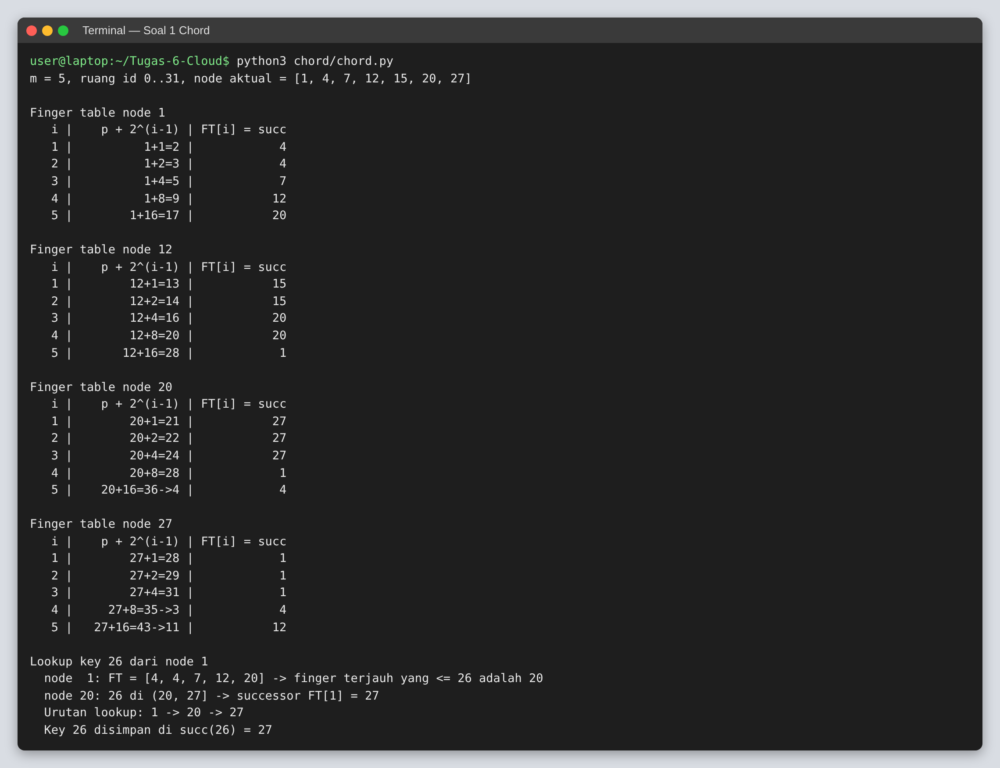
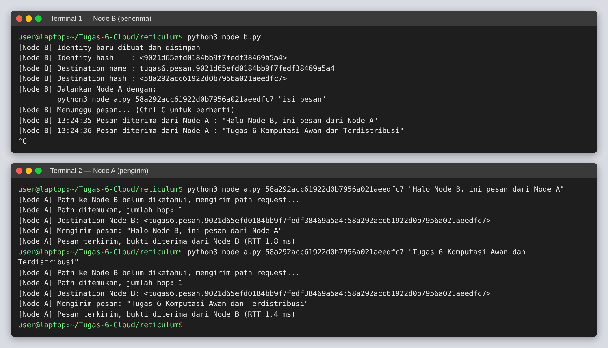

# Tugas 6 — Penamaan pada Sistem Terdistribusi

**CAK3EAB3 Komputasi Awan dan Terdistribusi** — Fakultas Informatika, Universitas Telkom

| Nama | NIM | Kontribusi Tugas |
|------|-----|------------------|
| … | … | … |

Isi repositori:

| Path | Isi |
|------|-----|
| `README.md` | Jawaban lengkap soal 1 dan 2 |
| `Jawaban_Tugas6.docx` | Jawaban yang sama dalam format Word |
| `chord/chord.py` | Script untuk memeriksa finger table dan urutan lookup Chord |
| `reticulum/node_a.py` | Program Node A (pengirim pesan) |
| `reticulum/node_b.py` | Program Node B (penerima pesan) |
| `reticulum/config_node_a/`, `reticulum/config_node_b/` | Konfigurasi Reticulum untuk tiap node |
| `screenshots/` | Screenshot hasil program |

---

## 1. Chord


Ruang identifier memiliki 32 posisi (0–31), sehingga **m = 5 bit**.
Node aktual (lingkaran yang diarsir) adalah **1, 4, 7, 12, 15, 20, 27**.

Rumus finger table node *p*:

```
FT_p[i] = succ(p + 2^(i-1))  (mod 2^m),   i = 1, 2, …, m
```

`succ(k)` adalah node aktual pertama yang identifier-nya ≥ k (searah jarum jam, kembali ke 0 setelah 31).

### 1a. Finger table

**Node 1**

| i | p + 2^(i−1) | succ | FT₁[i] |
|---|-------------|------|--------|
| 1 | 1 + 1 = 2 | succ(2) | **4** |
| 2 | 1 + 2 = 3 | succ(3) | **4** |
| 3 | 1 + 4 = 5 | succ(5) | **7** |
| 4 | 1 + 8 = 9 | succ(9) | **12** |
| 5 | 1 + 16 = 17 | succ(17) | **20** |

**Node 12**

| i | p + 2^(i−1) | succ | FT₁₂[i] |
|---|-------------|------|---------|
| 1 | 12 + 1 = 13 | succ(13) | **15** |
| 2 | 12 + 2 = 14 | succ(14) | **15** |
| 3 | 12 + 4 = 16 | succ(16) | **20** |
| 4 | 12 + 8 = 20 | succ(20) | **20** |
| 5 | 12 + 16 = 28 | succ(28) | **1** (melewati 31, kembali ke 0) |

**Node 20**

| i | p + 2^(i−1) | succ | FT₂₀[i] |
|---|-------------|------|---------|
| 1 | 20 + 1 = 21 | succ(21) | **27** |
| 2 | 20 + 2 = 22 | succ(22) | **27** |
| 3 | 20 + 4 = 24 | succ(24) | **27** |
| 4 | 20 + 8 = 28 | succ(28) | **1** |
| 5 | 20 + 16 = 36 mod 32 = 4 | succ(4) | **4** |

**Node 27**

| i | p + 2^(i−1) | succ | FT₂₇[i] |
|---|-------------|------|---------|
| 1 | 27 + 1 = 28 | succ(28) | **1** |
| 2 | 27 + 2 = 29 | succ(29) | **1** |
| 3 | 27 + 4 = 31 | succ(31) | **1** |
| 4 | 27 + 8 = 35 mod 32 = 3 | succ(3) | **4** |
| 5 | 27 + 16 = 43 mod 32 = 11 | succ(11) | **12** |

Ringkasan:

| i | FT₁ | FT₁₂ | FT₂₀ | FT₂₇ |
|---|-----|------|------|------|
| 1 | 4 | 15 | 27 | 1 |
| 2 | 4 | 15 | 27 | 1 |
| 3 | 7 | 20 | 27 | 1 |
| 4 | 12 | 20 | 1 | 4 |
| 5 | 20 | 1 | 4 | 12 |

### 1b. Urutan lookup untuk key 26 dari node 1

Aturan resolusi di node *p* untuk key *k* (Tanenbaum & van Steen):

- Jika `p < k ≤ FT_p[1]`, request diteruskan ke `FT_p[1]` (successor *p*) dan lookup selesai.
- Selain itu, request diteruskan ke `q = FT_p[j]` dengan `FT_p[j] ≤ k < FT_p[j+1]`, yaitu finger terjauh yang tidak melewati *k*.

Langkah:

1. **Node 1**: FT₁ = [4, 4, 7, 12, 20]. Key 26 tidak berada di (1, 4].
   Finger terjauh yang ≤ 26 adalah FT₁[5] = 20 (karena 20 ≤ 26 dan tidak ada finger berikutnya).
   → request diteruskan ke **node 20**.
2. **Node 20**: FT₂₀ = [27, 27, 27, 1, 4]. Karena 20 < 26 ≤ FT₂₀[1] = 27, key 26 berada di antara node 20 dan successor-nya.
   → request diteruskan ke **node 27**.
3. **Node 27** = succ(26), sehingga node 27 bertanggung jawab atas key 26. Lookup selesai.

**Urutan lookup: 1 → 20 → 27** (2 hop). Key 26 disimpan di **node 27**.

Hasil di atas juga diperiksa dengan `chord/chord.py`:



> Catatan: lingkaran 19 pada gambar memiliki garis tepi tebal tetapi tidak diarsir, sehingga di sini tidak dianggap node aktual.
> Jika 19 dianggap node aktual, yang berubah hanya FT₁[5] = 19 dan FT₁₂[3] = 19, dan urutan lookup menjadi 1 → 19 → 20 → 27.

---

## 2. Identity pada Reticulum

Referensi source code: **Reticulum Network Stack (`rns`) versi 1.5.7**
(<https://github.com/markqvist/Reticulum>), file `RNS/Identity.py`, `RNS/Destination.py`, dan `RNS/Reticulum.py`.
Nomor baris mengacu pada versi tersebut.

### 2a. Bagaimana identity pada Reticulum dibuat?

Identity di Reticulum adalah **pasangan kunci kriptografi**, bukan nama atau alamat IP. Satu identity terdiri dari dua pasang kunci pada kurva 25519:

- **X25519**: untuk pertukaran kunci ECDH dan enkripsi.
- **Ed25519**: untuk tanda tangan digital.

Ukuran kunci totalnya 512 bit (256 bit kunci enkripsi + 256 bit kunci tanda tangan):

```python
# RNS/Identity.py
59:    KEYSIZE     = 256*2
```

**Langkah 1: objek dibuat.** Konstruktor `Identity()` secara default memanggil `create_keys()`:

```python
# RNS/Identity.py
689:    def __init__(self,create_keys=True):
            ...
704:        if create_keys:
705:            self.create_keys()
```

**Langkah 2: kunci dibangkitkan secara acak.** Private key X25519 dan Ed25519 dibangkitkan, lalu public key masing-masing diturunkan dari private key-nya:

```python
# RNS/Identity.py
707:    def create_keys(self):
708:        self.prv           = X25519PrivateKey.generate()
709:        self.prv_bytes     = self.prv.private_bytes()
710:
711:        self.sig_prv       = Ed25519PrivateKey.generate()
712:        self.sig_prv_bytes = self.sig_prv.private_bytes()
713:
714:        self.pub           = self.prv.public_key()
715:        self.pub_bytes     = self.pub.public_bytes()
716:
717:        self.sig_pub       = self.sig_prv.public_key()
718:        self.sig_pub_bytes = self.sig_pub.public_bytes()
719:
720:        self.update_hashes()
```

**Langkah 3: public key gabungan dibentuk.** Public key sebuah identity (64 byte) adalah gabungan public key enkripsi dan public key tanda tangan:

```python
# RNS/Identity.py
731:    def get_public_key(self):
            ...
735:        if self.pub_bytes and self.sig_pub_bytes: return self.pub_bytes+self.sig_pub_bytes
```

**Langkah 4: identity hash dihitung.** Hash identity adalah SHA-256 dari public key, dipotong menjadi 128 bit (16 byte). Hash inilah yang menjadi "nama" unik sebuah identity:

```python
# RNS/Identity.py
787:    def update_hashes(self):
788:        self.hash = Identity.truncated_hash(self.get_public_key())
789:        self.hexhash = self.hash.hex()

352:    def full_hash(data):
            ...
359:        return RNS.Cryptography.sha256(data)

362:    def truncated_hash(data):
            ...
369:        return Identity.full_hash(data)[:(Identity.TRUNCATED_HASHLENGTH//8)]
```

```python
# RNS/Reticulum.py
148:    TRUNCATED_HASHLENGTH = 128
```

**Langkah 5 (opsional): identity disimpan dan dimuat ulang.** Agar identity tetap sama, private key (64 byte) disimpan ke file dengan `to_file()` dan dimuat lagi dengan `from_file()` / `load_private_key()`. Saat dimuat, public key dan hash diturunkan ulang dari private key:

```python
# RNS/Identity.py
641:    def from_file(path):
655:    def to_file(self, path):
666:                key_file.write(self.get_private_key())
738:    def load_private_key(self, prv_bytes):
            ...
757:            self.update_hashes()
```

**Kesimpulan 2a:**

```
identity      = (X25519 keypair, Ed25519 keypair)          dibangkitkan acak
public_key    = X25519_pub (32 B) || Ed25519_pub (32 B)    = 64 byte
identity_hash = SHA-256(public_key)[0:16]                  = 128 bit
```

Karena hash diturunkan dari public key, identity bersifat **self-certifying**: tidak dibutuhkan otoritas pusat untuk memberi nama, dan siapa pun dapat memverifikasi bahwa sebuah public key memang milik hash tersebut.

### 2b. Bagaimana destination pada Reticulum dibuat?

Destination adalah **endpoint yang bisa dialamati** di jaringan Reticulum, mirip "alamat + port" pada TCP/IP. Destination dibuat dengan:

```python
RNS.Destination(identity, direction, type, app_name, *aspects)
```

- `direction`: `IN` (menerima) atau `OUT` (mengirim ke destination lain).
- `type`: `SINGLE` (terenkripsi ke satu identity), `GROUP`, `PLAIN`, atau `LINK`.

```python
# RNS/Destination.py
63:    SINGLE     = 0x00
65:    PLAIN      = 0x02
79:    IN         = 0x11;
80:    OUT        = 0x12;
```

**Langkah 1: validasi dan identity.** Jika destination `IN` bukan `PLAIN` dibuat tanpa identity, Reticulum otomatis membuat identity baru. Destination `OUT` bertipe `SINGLE` wajib memiliki identity (public key tujuan). Destination `PLAIN` tidak boleh memiliki identity:

```python
# RNS/Destination.py
149:    def __init__(self, identity, direction, type, app_name, *aspects):
            ...
175:        if identity == None and direction == Destination.IN and self.type != Destination.PLAIN:
176:            identity = RNS.Identity()
177:            aspects = aspects+(identity.hexhash,)
178:
179:        if identity == None and direction == Destination.OUT and self.type != Destination.PLAIN:
180:            raise ValueError("Can't create outbound SINGLE destination without an identity")
181:
182:        if identity != None and self.type == Destination.PLAIN:
183:            raise TypeError("Selected destination type PLAIN cannot hold an identity")
```

**Langkah 2: nama lengkap disusun.** Nama berbentuk `app_name.aspect1.aspect2....identity_hexhash`. Karakter titik tidak boleh dipakai di dalam app name atau aspect:

```python
# RNS/Destination.py
96:     def expand_name(identity, app_name, *aspects):
            ...
104:        name = app_name
105:        for aspect in aspects:
106:            if "." in aspect: raise ValueError("Dots can't be used in aspects")
107:            name += "." + aspect
108:
109:        if identity != None:
110:            name += "." + identity.hexhash

186:        self.name = Destination.expand_name(identity, app_name, *aspects)
```

**Langkah 3: destination hash (alamat) dihitung.**

1. `name_hash` = SHA-256 dari nama *tanpa* identity (`app_name.aspects`), dipotong menjadi 80 bit (10 byte).
2. `destination_hash` = SHA-256(`name_hash` ‖ `identity.hash`), dipotong menjadi 128 bit (16 byte).

```python
# RNS/Destination.py
116:    def hash(identity, app_name, *aspects):
            ...
120:        name_hash = RNS.Identity.full_hash(Destination.expand_name(None, app_name, *aspects).encode("utf-8"))[:(RNS.Identity.NAME_HASH_LENGTH//8)]
121:        addr_hash_material = name_hash
122:        if identity != None:
123:            if isinstance(identity, RNS.Identity):
124:                addr_hash_material += identity.hash
            ...
130:        return RNS.Identity.full_hash(addr_hash_material)[:RNS.Reticulum.TRUNCATED_HASHLENGTH//8]

188:        # Generate the destination address hash
189:        self.hash = Destination.hash(self.identity, app_name, *aspects)
190:        self.name_hash = RNS.Identity.full_hash(self.expand_name(None, app_name, *aspects).encode("utf-8"))[:(RNS.Identity.NAME_HASH_LENGTH//8)]
```

```python
# RNS/Identity.py
83:    NAME_HASH_LENGTH          = 80
```

**Langkah 4: destination didaftarkan ke Transport.** Destination `IN` dimasukkan ke tabel `Transport.destinations_map`, sehingga paket yang alamatnya sama dengan `destination.hash` akan diteruskan ke destination ini:

```python
# RNS/Destination.py
197:        RNS.Transport.register_destination(self)
```

```python
# RNS/Transport.py
2898:    def register_destination(destination):
            ...
2909:                Transport.destinations_map[destination.hash] = destination
```

**Langkah 5: destination di-announce agar dapat ditemukan.** Announce berisi public key identity, `name_hash`, random hash, dan tanda tangan Ed25519. Node lain menyimpan public key dari announce ini (`Identity.remember`) dan nanti mengambilnya kembali dengan `Identity.recall(destination_hash)` untuk membuat destination `OUT`:

```python
# RNS/Destination.py
244:    def announce(self, app_data=None, path_response=False, attached_interface=None, tag=None, send=True):
            ...
298:            signed_data = self.hash+self.identity.get_public_key()+self.name_hash+random_hash+ratchet
            ...
301:            signature = self.identity.sign(signed_data)
302:            announce_data = self.identity.get_public_key()+self.name_hash+random_hash+ratchet+signature
            ...
314:        announce_packet = RNS.Packet(self, announce_data, RNS.Packet.ANNOUNCE, context = announce_context,
```

**Kesimpulan 2b:**

```
full_name        = app_name.aspect1...aspectN.identity_hexhash
name_hash        = SHA-256("app_name.aspect1...aspectN")[0:10]     (80 bit)
destination_hash = SHA-256(name_hash || identity_hash)[0:16]       (128 bit)
```

**Pembuktian dengan hasil program 2c.** Node B memiliki identity hash `9021d65efd0184bb9f7fedf38469a5a4` dan destination `tugas6.pesan`. Jika dihitung manual:

```python
>>> import hashlib
>>> nh = hashlib.sha256(b"tugas6.pesan").digest()[:10]
>>> nh.hex()
'adc85445964be981e465'
>>> hashlib.sha256(nh + bytes.fromhex("9021d65efd0184bb9f7fedf38469a5a4")).digest()[:16].hex()
'58a292acc61922d0b7956a021aeedfc7'
```

Hasilnya `58a292acc61922d0b7956a021aeedfc7`, sama dengan destination hash yang dicetak Node B pada screenshot 2c.

### 2c. Program pengiriman pesan dari Node A ke Node B

Kedua node menjalankan instance Reticulum masing-masing (config dir terpisah) dan terhubung lewat interface TCP:

- **Node B** (`TCPServerInterface`, 127.0.0.1:4242) membuat identity dan destination `IN SINGLE tugas6.pesan`, melakukan announce, lalu mencetak setiap pesan yang masuk.
- **Node A** (`TCPClientInterface` ke 127.0.0.1:4242) melakukan path request ke destination hash Node B, mengambil public key Node B dengan `Identity.recall()`, membuat destination `OUT SINGLE`, lalu mengirim `RNS.Packet` yang terenkripsi. Node B mengirim balik bukti penerimaan (proof), sehingga Node A tahu pesannya sudah sampai.

Untuk menjalankan Node A dan Node B di dua komputer berbeda, ubah `listen_ip` di `config_node_b/config` menjadi `0.0.0.0` dan `target_host` di `config_node_a/config` menjadi IP komputer Node B.

#### Cara menjalankan

```bash
pip install rns

cd reticulum
# Terminal 1
python3 node_b.py
# Terminal 2 (pakai destination hash yang dicetak Node B)
python3 node_a.py <destination_hash_node_b> "Halo Node B, ini pesan dari Node A"
```

#### Source code `reticulum/node_b.py`

```python
#!/usr/bin/env python3
"""
Tugas 6 - Node B (penerima pesan) menggunakan Reticulum Network Stack (RNS).

Node B:
  1. Menjalankan instance Reticulum dengan konfigurasi di ./config_node_b
  2. Memuat (atau membuat) Identity -> pasangan kunci X25519 + Ed25519
  3. Membuat Destination IN/SINGLE "tugas6.pesan"
  4. Meng-announce destination tersebut ke jaringan
  5. Menampilkan setiap pesan yang diterima dari Node A

Jalankan:  python3 node_b.py
"""

import os
import sys
import time

import RNS

APP_NAME = "tugas6"
ASPECT   = "pesan"

BASE_DIR      = os.path.dirname(os.path.abspath(__file__))
CONFIG_DIR    = os.path.join(BASE_DIR, "config_node_b")
IDENTITY_PATH = os.path.join(CONFIG_DIR, "identity_node_b")


def load_or_create_identity():
    # Identity disimpan ke file agar hash destination Node B tetap sama
    # setiap kali program dijalankan ulang.
    if os.path.isfile(IDENTITY_PATH):
        identity = RNS.Identity.from_file(IDENTITY_PATH)
        print("[Node B] Identity dimuat dari file")
    else:
        identity = RNS.Identity()
        identity.to_file(IDENTITY_PATH)
        print("[Node B] Identity baru dibuat dan disimpan")
    return identity


def packet_received(data, packet):
    pesan = data.decode("utf-8")
    waktu = time.strftime("%H:%M:%S")
    print(f"[Node B] {waktu} Pesan diterima dari Node A : \"{pesan}\"")
    sys.stdout.flush()


def main():
    RNS.Reticulum(configdir=CONFIG_DIR)

    identity = load_or_create_identity()

    destination = RNS.Destination(
        identity,
        RNS.Destination.IN,
        RNS.Destination.SINGLE,
        APP_NAME,
        ASPECT,
    )
    # Kirim bukti penerimaan (proof) otomatis untuk setiap paket
    destination.set_proof_strategy(RNS.Destination.PROVE_ALL)
    destination.set_packet_callback(packet_received)

    print(f"[Node B] Identity hash    : {RNS.prettyhexrep(identity.hash)}")
    print(f"[Node B] Destination name : {destination.name}")
    print(f"[Node B] Destination hash : {RNS.prettyhexrep(destination.hash)}")
    print(f"[Node B] Jalankan Node A dengan:")
    print(f"         python3 node_a.py {destination.hexhash} \"isi pesan\"")
    print("[Node B] Menunggu pesan... (Ctrl+C untuk berhenti)")
    sys.stdout.flush()

    # Announce secara berkala agar Node A dapat menemukan path & public key
    try:
        while True:
            destination.announce()
            time.sleep(10)
    except KeyboardInterrupt:
        print("\n[Node B] Berhenti")


if __name__ == "__main__":
    main()
```

#### Source code `reticulum/node_a.py`

```python
#!/usr/bin/env python3
"""
Tugas 6 - Node A (pengirim pesan) menggunakan Reticulum Network Stack (RNS).

Node A:
  1. Menjalankan instance Reticulum dengan konfigurasi di ./config_node_a
  2. Mencari path ke destination hash milik Node B (request_path)
  3. Mengambil public key Node B dari announce (Identity.recall)
  4. Membuat Destination OUT/SINGLE "tugas6.pesan" milik Node B
  5. Mengirim pesan terenkripsi ke Node B dan menunggu bukti penerimaan

Jalankan:  python3 node_a.py <destination_hash_node_b> ["isi pesan"]
Jika isi pesan tidak diberikan, program masuk ke mode interaktif.
"""

import os
import sys
import time

import RNS

APP_NAME = "tugas6"
ASPECT   = "pesan"

BASE_DIR   = os.path.dirname(os.path.abspath(__file__))
CONFIG_DIR = os.path.join(BASE_DIR, "config_node_a")

PATH_TIMEOUT  = 30
PROOF_TIMEOUT = 15


def resolve_destination(destination_hash):
    if not RNS.Transport.has_path(destination_hash):
        print("[Node A] Path ke Node B belum diketahui, mengirim path request...")
        RNS.Transport.request_path(destination_hash)
        deadline = time.time() + PATH_TIMEOUT
        while not RNS.Transport.has_path(destination_hash):
            if time.time() > deadline:
                print("[Node A] Gagal menemukan path ke Node B")
                sys.exit(1)
            time.sleep(0.1)

    print(f"[Node A] Path ditemukan, jumlah hop: {RNS.Transport.hops_to(destination_hash)}")

    # Public key Node B diperoleh dari announce yang sudah diterima
    identity_b = RNS.Identity.recall(destination_hash)
    destination_b = RNS.Destination(
        identity_b,
        RNS.Destination.OUT,
        RNS.Destination.SINGLE,
        APP_NAME,
        ASPECT,
    )
    print(f"[Node A] Destination Node B: {destination_b}")
    return destination_b


def send_message(destination_b, pesan):
    packet  = RNS.Packet(destination_b, pesan.encode("utf-8"))
    receipt = packet.send()
    print(f"[Node A] Mengirim pesan: \"{pesan}\"")

    receipt.set_timeout(PROOF_TIMEOUT)
    while receipt.status == RNS.PacketReceipt.SENT:
        time.sleep(0.1)

    if receipt.status == RNS.PacketReceipt.DELIVERED:
        rtt = receipt.get_rtt()
        print(f"[Node A] Pesan terkirim, bukti diterima dari Node B (RTT {rtt*1000:.1f} ms)")
    else:
        print("[Node A] Bukti penerimaan tidak diterima (timeout)")


def main():
    if len(sys.argv) < 2:
        print(f"Penggunaan: python3 {sys.argv[0]} <destination_hash_node_b> [\"isi pesan\"]")
        sys.exit(1)

    dest_len = (RNS.Reticulum.TRUNCATED_HASHLENGTH // 8) * 2
    hexhash  = sys.argv[1].strip("<>")
    if len(hexhash) != dest_len:
        print(f"Destination hash harus {dest_len} karakter heksadesimal")
        sys.exit(1)
    destination_hash = bytes.fromhex(hexhash)

    RNS.Reticulum(configdir=CONFIG_DIR)
    destination_b = resolve_destination(destination_hash)

    if len(sys.argv) >= 3:
        send_message(destination_b, " ".join(sys.argv[2:]))
        return

    print("[Node A] Ketik pesan lalu Enter (Ctrl+C untuk keluar)")
    try:
        while True:
            pesan = input("> ")
            if pesan:
                send_message(destination_b, pesan)
    except (KeyboardInterrupt, EOFError):
        print("\n[Node A] Selesai")


if __name__ == "__main__":
    main()
```

#### Konfigurasi interface

`reticulum/config_node_b/config`:

```ini
[reticulum]
  enable_transport = False
  share_instance = No
  panic_on_interface_error = No

[logging]
  loglevel = 4

[interfaces]
  [[TCP Server Node B]]
    type = TCPServerInterface
    enabled = yes
    listen_ip = 127.0.0.1
    listen_port = 4242
```

`reticulum/config_node_a/config`:

```ini
[reticulum]
  enable_transport = False
  share_instance = No
  panic_on_interface_error = No

[logging]
  loglevel = 4

[interfaces]
  [[TCP Client ke Node B]]
    type = TCPClientInterface
    enabled = yes
    target_host = 127.0.0.1
    target_port = 4242
```

#### Screenshot hasil

Terminal 1 menjalankan Node B, Terminal 2 menjalankan Node A. Node B menampilkan kedua pesan yang dikirim Node A, dan Node A menerima bukti penerimaan dari Node B:


